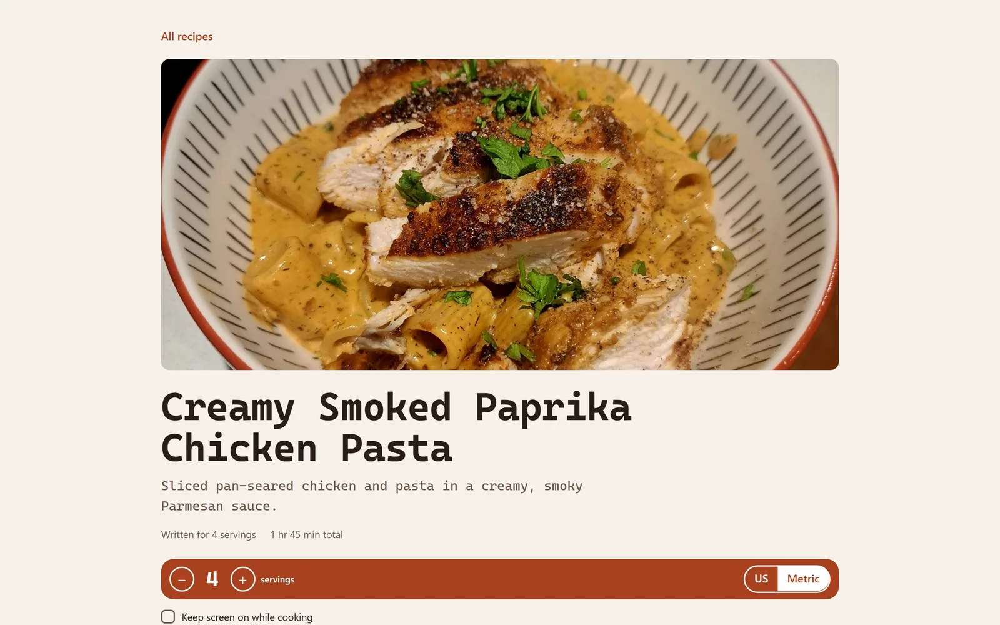
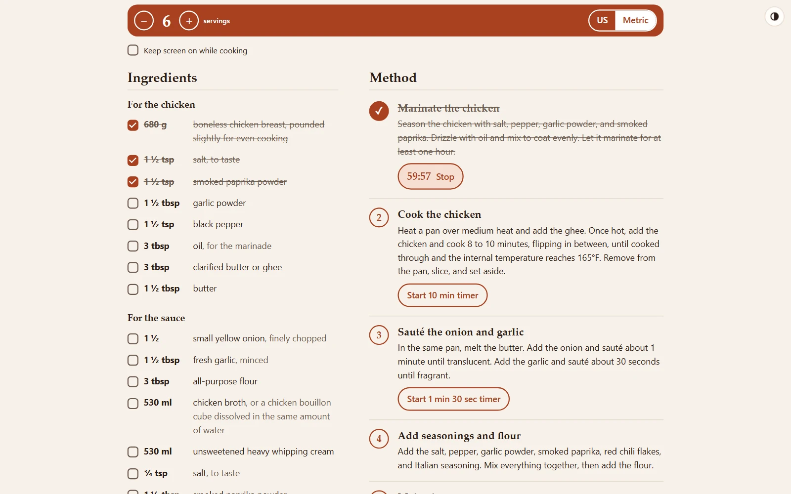
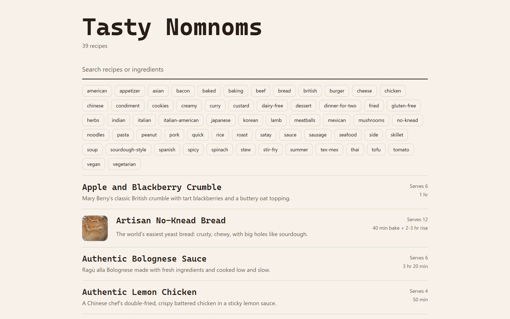
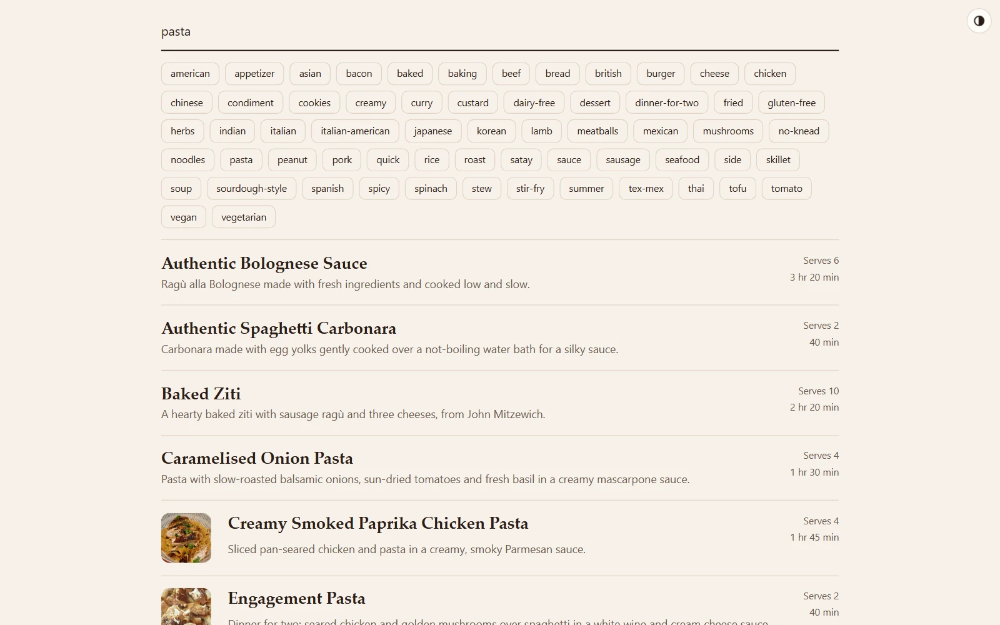
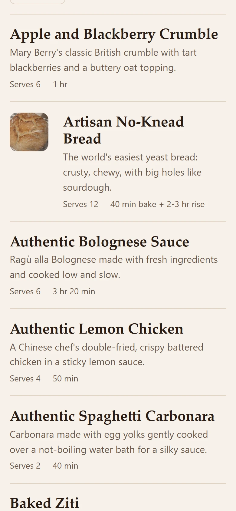
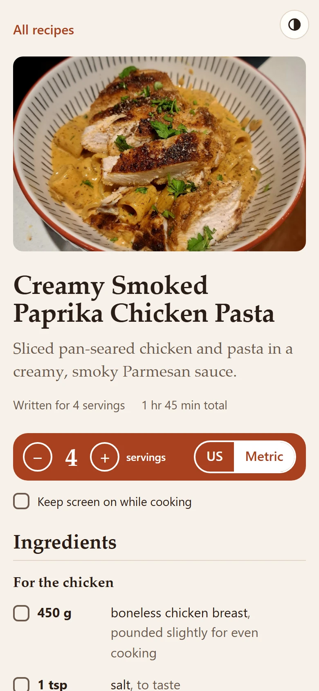
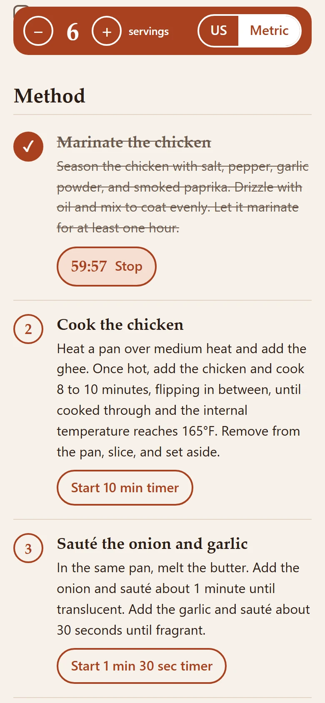
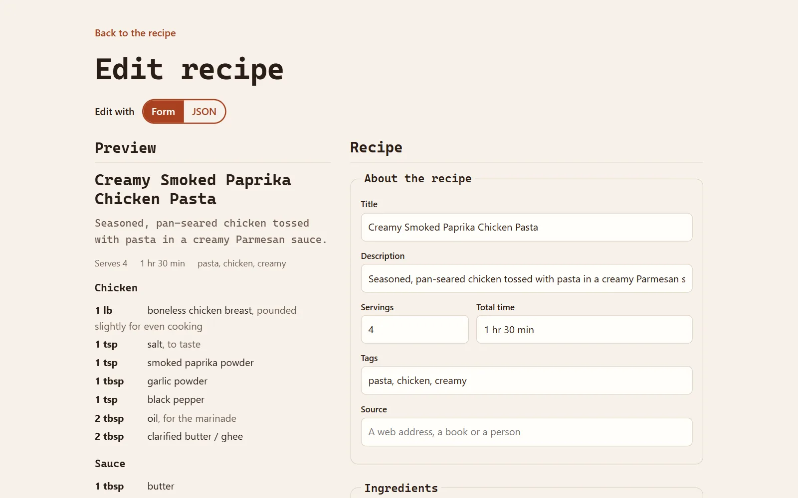
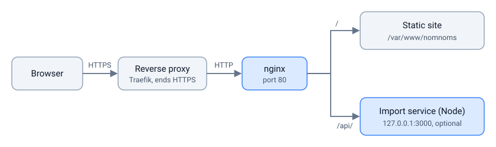

# Nammet Recipe Website

A self-hosted recipe website for one household or a small group. Recipes are plain JSON files in a folder, the front end is a single HTML page with vanilla JavaScript and CSS, and nginx serves the lot. There is no database, no build step and no front-end dependencies.

An optional Node service adds sign-in, recipe import (from a file, a web page or pasted text), adding recipes in a form, and an admin page. Without it, the site still browses and cooks.

**Documentation:** <https://foshiee.github.io/nammet-recipe-website/>

## Screenshots

The light and dark shots follow your GitHub theme, as the site follows your system's unless you pick one.

<picture>
  <source media="(prefers-color-scheme: dark)" srcset="docs/screenshots/recipe-desktop-dark.webp">
  
</picture>

Cooking: scaled from 4 to 6 servings and switched to metric, with ingredients and the first step ticked off and its timer running.



<picture>
  <source media="(prefers-color-scheme: dark)" srcset="docs/screenshots/home-desktop-dark.webp">
  
</picture>

Searching covers titles, descriptions, tags and ingredients:



On a phone, the servings bar stays at the top of the screen while you cook:

<table>
  <tr>
    <td>
      <picture>
        <source media="(prefers-color-scheme: dark)" srcset="docs/screenshots/home-phone-dark.webp">
        
      </picture>
    </td>
    <td>
      <picture>
        <source media="(prefers-color-scheme: dark)" srcset="docs/screenshots/recipe-phone-dark.webp">
        
      </picture>
    </td>
    <td>
      
    </td>
  </tr>
</table>

## Features

**For cooking**

- Search across titles, descriptions, tags and ingredients.
- Scale any recipe to a different number of servings.
- Switch between US and metric units. Conversions cover common volume and weight units; anything unrecognised (a "handful", a "pinch") passes through unchanged.
- Tick off ingredients and steps as you go.
- Step timers with an alarm that keeps beeping until you dismiss it.
- A "Keep screen on" option, using the Screen Wake Lock API, so your phone doesn't lock with flour on your hands.
- Light and dark mode follow the system setting, or a button in the corner of every page forces either one (remembered per browser).

**With the import service**

- Import from a recipe web page. Pages with schema.org Recipe markup (most recipe sites) are parsed directly with no AI involved, and the page's photo comes along.
- Import from a PDF, a photo of a cookbook page, plain text or a page without markup, using Claude through the Anthropic API. This is the only feature that needs an API key.
- Write a recipe yourself in the same form, with a live preview and a photo.
- Review every import before saving: a preview, an editor, and validation warnings such as quantities written into step text (which wouldn't scale).
- Edit saved recipes from the recipe page, in a form or as raw JSON (the site remembers which you prefer). If someone else saves the recipe while you're editing, you're asked before anything is overwritten.
- Add, crop and replace recipe photos. Photos are re-encoded in the browser, which strips EXIF and GPS data, and stripped again on the server.
- An admin page for user accounts (admin and importer roles), the site name and favicon, colour themes (including colourblind-friendly ones) with a contrast checker, fonts and corner radius, and the Claude model and API key.

Editing a saved recipe in the form, with a live preview beside it:

<picture>
  <source media="(prefers-color-scheme: dark)" srcset="docs/screenshots/edit-desktop-dark.webp">
  
</picture>

## How it fits together

<picture>
  <source media="(prefers-color-scheme: dark)" srcset="docs/diagrams/overview-dark.svg">
  
</picture>


nginx lists the `recipes/` folder as JSON (`autoindex_format json`), and the app fetches that listing to find recipes. Dropping a new `.json` file into the folder makes it appear on the next page refresh. If you'd rather not use nginx's listing, a `recipes/index.json` holding an array of file names works too.

The repo mirrors the server's filesystem, so `var/www/nammet/` deploys to `/var/www/nammet/`, `opt/nammet-api/` to `/opt/nammet-api/`, and so on.

| Path | What it is |
|---|---|
| `var/www/nammet/` | The website: `index.html`, `app.js`, `style.css`, `recipes/`, `photos/` |
| `opt/nammet-api/` | The optional Node service (Node 20+, two dependencies) |
| `etc/nginx/` | nginx config, including rate limits and an AI-crawler block |
| `etc/systemd/system/` | systemd unit for the service, sandboxed to the folders it writes |
| `etc/nammet/api.env.example` | Service settings template |
| `docs/` | Recipe format spec, server setup guide and an example recipe |

## Quick start

### Just the website

Copy `var/www/nammet/` to any web server that can return a JSON directory listing for `recipes/` (the included nginx config does this), or add a `recipes/index.json`:

```json
["example-recipe.json", "garlic-tomato-spaghetti.json"]
```

Then write recipes by hand following [docs/recipe-format.md](docs/recipe-format.md). The smallest valid recipe is a title, ingredients and steps:

```json
{
  "title": "Buttered Toast",
  "ingredients": [
    { "amount": 2, "name": "slices of bread" },
    { "amount": 1, "unit": "tbsp", "name": "butter" }
  ],
  "steps": ["Toast the bread.", "Spread with butter while hot."]
}
```

### Running locally with the service

The service can serve the site itself and emulate nginx's folder listing, so you don't need nginx on your own machine:

```sh
cd opt/nammet-api
npm install
USERS_FILE=./dev-users.json node tools/add-user.js tester --role admin --permanent
mkdir -p ../../var/www/nammet/theme
USERS_FILE=./dev-users.json SETTINGS_FILE=./dev-settings.json THEME_DIR=../../var/www/nammet/theme \
  RECIPES_DIR=../../var/www/nammet/recipes PHOTOS_DIR=../../var/www/nammet/photos \
  DEV_STATIC_ROOT=../../var/www/nammet COOKIE_SECURE=false node server.js
```

`add-user.js` asks for a password. Open http://127.0.0.1:3000 and sign in as `tester` with it. On PowerShell, set each variable with `$env:USERS_FILE = "./dev-users.json"` and so on.

Run the service's tests with `npm test`. They use Node's built-in test runner and need neither network access nor an API key.

### Deploying to a server

Three ways, all expecting an HTTPS reverse proxy such as Traefik in front:

- **Docker:** `ghcr.io/foshiee/nammet-recipe-website` holds nginx and the import service in one image. See [docs/docker.md](docs/docker.md).
- **install.sh:** on a RHEL-family or Debian/Ubuntu server, clone the repo and run `./install.sh`. Run it again after `git pull` to update. See [Quick install](docs/install.md#quick-install-with-installsh).
- **By hand:** [docs/install.md](docs/install.md) walks through a full install on a fresh Rocky Linux 10 VM: packages, the service account, systemd, SELinux, nginx, and a security checklist for running behind Traefik. It also covers what Claude imports cost.

## Recipe format

Each recipe is one UTF-8 JSON file named in kebab-case, such as `garlic-tomato-spaghetti.json`. The file name becomes the recipe's URL (`#/r/garlic-tomato-spaghetti`), so renaming a file breaks bookmarks to it.

Recipes can have a description, servings, a time, tags, a source, a photo, grouped ingredients ("Sauce", "To serve"), step titles, per-step timers and notes. [docs/example-recipe.json](docs/example-recipe.json) uses every field, and [docs/recipe-format.md](docs/recipe-format.md) is the full spec.

Keep quantities in the ingredient list rather than in step text. Ingredient amounts scale and convert; step text is shown as written.

## Security

The import service is built to sit on the public internet behind HTTPS:

- Passwords are hashed with scrypt, and logins are rate-limited per IP and per username.
- Sessions use `SameSite=Strict` cookies, and every POST needs an `X-Requested-With` header as CSRF protection.
- Passwords an admin sets are temporary; the user must change theirs before doing anything else. There is no self-service password reset.
- URL imports refuse private and internal addresses, check every redirect hop, and cap size and time, to prevent server-side request forgery.
- The systemd unit lets the service write only to the recipes, photos and theme folders and its own state directory.
- The Anthropic API key is write-only on the admin page: it is never sent back to the browser, which only sees its last four characters.

nginx returns 403 to known AI crawlers and scraping libraries, and `robots.txt` asks the same crawlers to stay away.

## Support

Nammet Recipe Website is free, and you can use it however you like. If it's earned a place in your kitchen, you can [buy me a pint🍺 on Ko-fi](https://ko-fi.com/foshiee).

## License

Released under the [MIT License](LICENSE).
